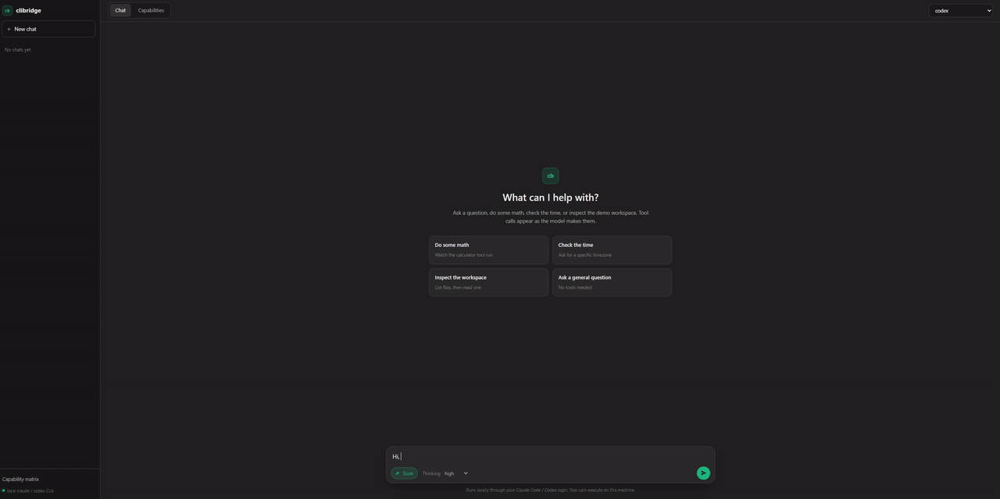

# Chat UI

A local ChatGPT-style web interface for clibridge. Replies stream over SSE, tool calls are shown as
they happen, and the same app includes the capability matrix.



## Run

From the repo root:

```bash
pip install -e ".[chat]"
python examples/chat/app.py
```

Open <http://127.0.0.1:8788>. The server listens on localhost only.

You need at least one CLI installed and logged in (`clibridge doctor --ping`). Pick
`claude-code`, `claude-code/opus`, `claude-code/sonnet`, `claude-code/haiku`, or `codex`
from the model menu.

## What it does

- Streams replies token by token through `POST /api/chat/stream`.
- Shows reasoning summaries when the CLI returns them.
- Runs local tools and displays their arguments and results inline:
  - `calculate` evaluates arithmetic with a safe AST walker.
  - `get_current_time` supports IANA timezones such as `Asia/Tokyo`.
  - `list_files` and `read_file` are confined to `workdir/`.
- Keeps conversations in the browser's local storage.
- Includes the capability matrix tab, backed by `capabilities.py`, with per-test and
  "Run all" execution.

`workdir/task.txt` is sample data for the file tools. Add more files there or edit it to try
the tools on your own content.

## Files

| File | Purpose |
|---|---|
| `app.py` | FastAPI app, SSE chat endpoint, tool loop and capability endpoints |
| `chat_tools.py` | Tool schemas and the sandboxed implementations |
| `capabilities.py` | The 16-test matrix across the OpenAI, Anthropic, LiteLLM, LangChain and Agents SDKs |
| `run_matrix.py` | CLI runner for the matrix (`python examples/chat/run_matrix.py --model both`) |
| `static/` | The web UI |

Each message starts a real `claude` or `codex` process, so replies take a few seconds and count
against your plan's limits. "Run all" in the matrix starts 16 calls.
